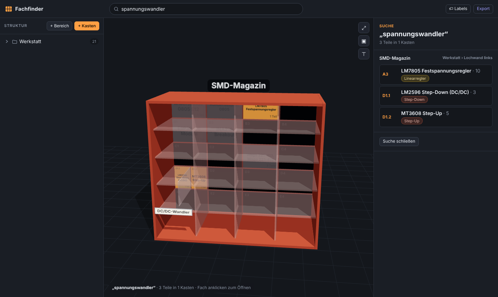
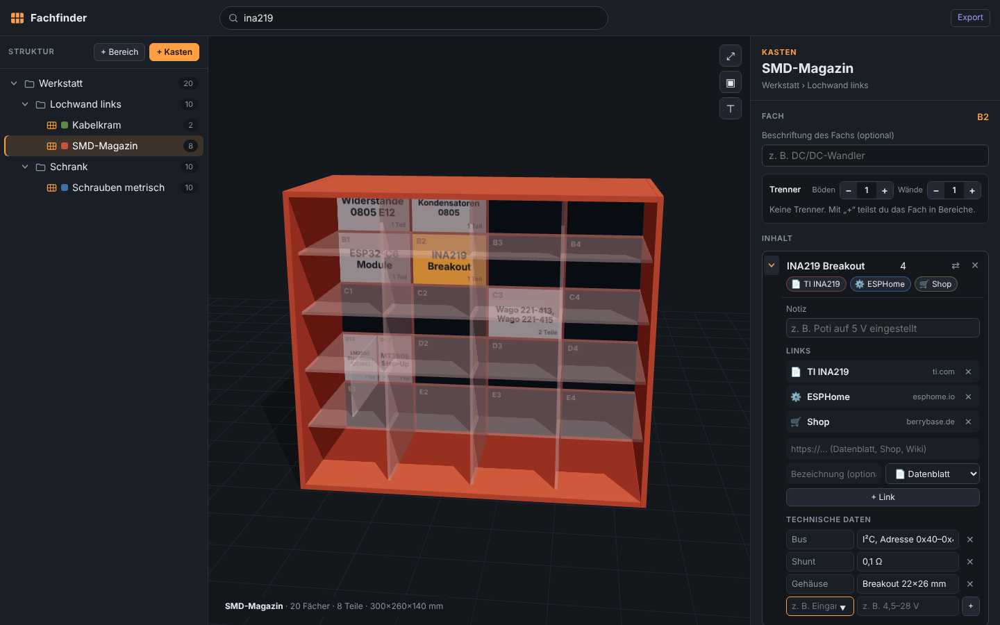
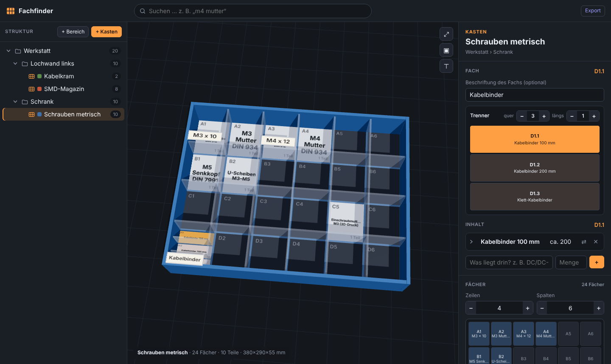

# Fachfinder für Home Assistant

**Virtuelle Sortierkästen in 3D.** Leg deine Werkstatt als Baum aus Räumen, Wänden und Schränken an. Jeder Sortierkasten bekommt Fächer und Trenner, und in jedes Fach trägst du ein, was darin liegt, samt Datenblatt-Link, technischen Daten und Labels. Wenn du etwas suchst, leuchtet das Fach auf.



## Installation

[](https://my.home-assistant.io/redirect/supervisor_add_addon_repository/?repository_url=https%3A%2F%2Fgithub.com%2Fcuvy95%2Ffachfinder-ha)

1. Klick auf den Button oben. Alternativ öffnest du *Einstellungen → Apps → App-Store → ⋮ → Repositories* und fügst diese URL hinzu:
   `https://github.com/cuvy95/fachfinder-ha`
2. Suche im App-Store nach **Fachfinder** und installiere es.
3. **Starten** und **In Seitenleiste anzeigen** aktivieren. Fertig.

Voraussetzung ist Home Assistant OS oder Supervised (also mit Apps). Unterstützt werden amd64 (PC, NUC, VM) und aarch64 (Raspberry Pi 4/5, Home Assistant Green und Yellow).

## Funktionen

- **Baumstruktur** wie im CAD-Programm: Bereiche (Räume, Wände, Schränke) beliebig verschachteln
- **3D-Ansicht** jedes Kastens, liegend (Sortierkasten) oder stehend (Regal/Magazin), dreh- und zoombar
- **Fächer verbinden und teilen**, Zeilen und Spalten frei wählbar
- **Doppelseitige Sortierkästen**: Rückseite mit eigenem Raster und Inhalt, Umschalter Seite A/B, beide Seiten nebeneinander in 2D und 3D
- **Trenner** pro Fach: Bereiche wie *A1.1, A1.2* und ein **Beschriftungsschild** vorne am Fach
- Pro Teil: **Menge, Notiz, Links** (📄 Datenblatt, 🛒 Shop, ⚙️ Konfiguration, 📘 Doku) und **technische Daten**
- **Labels mit Oberbegriffen und Synonymen**: „Spannungswandler“ findet z. B. alle Step-Down-, Step-Up- und Linearregler
- **Suche** über alles; „Alle Treffer zeigen“ markiert jedes passende Fach in 3D
- **Export und Import** (JSON); die Daten sind automatisch im **HA-Backup**
- Läuft über HA-Ingress: Login, HTTPS und Fernzugriff übernimmt Home Assistant

| Fach mit Links, Labels und Daten | Liegender Sortierkasten |
|---|---|
|  |  |

## Sprachsuche mit Assist: „Wo liegt der Step-Down?“

Den **internen Hostnamen** der App findest du oben auf ihrer Info-Seite, z. B. `a1b2c3d4-fachfinder`.

`configuration.yaml` (danach HA neu starten):
```yaml
rest_command:
  fachfinder_suche:
    url: "http://<HOSTNAME>:8099/api/search?q={{ q | urlencode }}"
    method: get
```

Automation (in YAML einfügen):
```yaml
alias: Fachfinder – Wo liegt?
triggers:
  - trigger: conversation
    command:
      - "wo liegt [der|die|das] {teil}"
      - "wo liegen [die] {teil}"
      - "wo finde ich [den|die|das] {teil}"
actions:
  - action: rest_command.fachfinder_suche
    data:
      q: "{{ trigger.slots.teil }}"
    response_variable: res
  - set_conversation_response: >
      
      Dazu habe ich nichts gefunden.
      {{ r[0].item }} liegt in {{ r[0].box }}, Fach {{ r[0].fach }}.
      Ich habe {{ r | count }} Treffer: {{ t.item }} in {{ t.box }} Fach {{ t.fach }}{{ ', ' if not loop.last }}.
```

Bei doppelseitigen Kästen nennt die Antwort die Seite mit, z. B. „Elektronik (Seite B), Fach B3“. Die Seite allein steht zusätzlich im Feld `side` (`A`, `B` oder leer).

## Umzug von einer anderen Fachfinder-Installation

Klick in der alten Installation oben rechts auf **Export**, in der App auf **Import**, und wähle die Datei aus. Vor dem Import legt Fachfinder automatisch eine Sicherung an.

---

## Für Entwickler und Maintainer

### Neue Version veröffentlichen
1. Änderungen in `fachfinder/app/` vornehmen.
2. Die Version an **drei Stellen gleich** setzen:
   - `fachfinder/config.yaml` → `version`
   - `fachfinder/app/main.py` → `APP_VERSION`
   - `fachfinder/app/static/app.js` → `APP_VERSION`
3. `fachfinder/CHANGELOG.md` ergänzen und auf `main` pushen.
4. Die GitHub Action baut die Images, das dauert etwa 5–10 Minuten (Tab *Actions*). Danach zeigt Home Assistant das Update an.

### Einmalig nach dem ersten Build
Die Images landen unter *Packages* in deinem GitHub-Profil und sind **zunächst privat**. Für **beide** Pakete (`amd64-fachfinder` und `aarch64-fachfinder`) musst du unter *Package settings → Change visibility* die Sichtbarkeit auf **Public** stellen. Sonst kann Home Assistant sie nicht herunterladen.

### Lokal starten (ohne Home Assistant)
```bash
cd fachfinder/app
pip install -r requirements.txt
python main.py        # → http://localhost:8099
```

### Als lokale App testen (ohne fertige Images)
Kopiere den Ordner `fachfinder/` nach `/addons/fachfinder/` auf Home Assistant und **entferne dort die Zeile `image:`** aus der `config.yaml`. Dann baut HA das Image selbst.

### Aufbau
```
fachfinder/
├── config.yaml        App-Konfiguration (Version, Ingress, Images)
├── Dockerfile
├── CHANGELOG.md       wird in HA beim Update angezeigt
├── DOCS.md            Doku-Tab der App in HA
└── app/
    ├── main.py        Backend: FastAPI + SQLite (/data/fachfinder.db)
    └── static/        Oberfläche: index.html, app.js, style.css, three.js
```

API-Dokumentation: `http://<HOSTNAME>:8099/api/docs`

## Lizenz
MIT, siehe [LICENSE](LICENSE). Enthält [three.js](https://threejs.org) (MIT).
